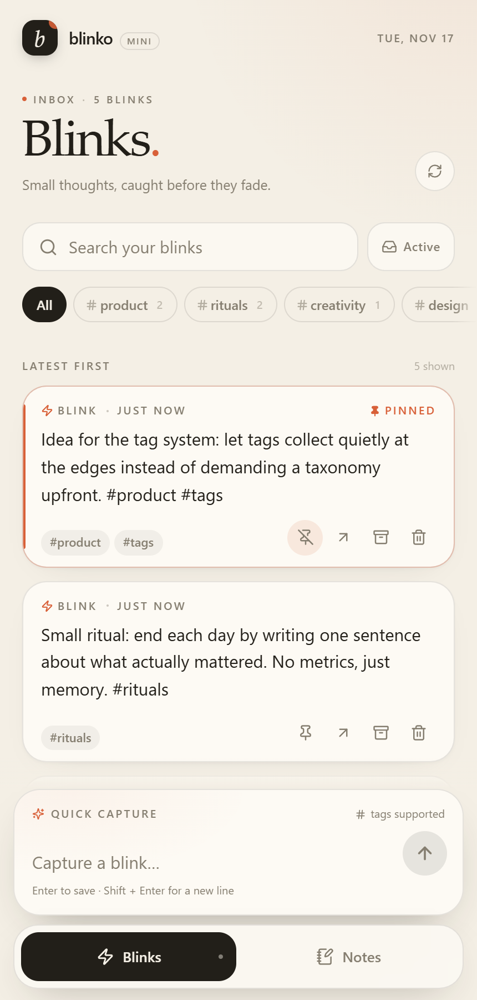

# Blinko-Mini

A quiet, single-user idea capture and note-taking app that lives inside Telegram.

Capture a **Blink** from the bot chat or the Mini App's quick-capture dock, let it grow into a Markdown **Note**, and keep everything findable with `#tags` and SQLite full-text search. Warm paper, native Telegram theming, zero AI, zero media, zero ceremony.



## What it does

- **Capture fast** — text sent to the bot or typed into the dock is saved as a Blink in one action.
- **Grow ideas** — a full-screen editor with title, Markdown-friendly body, inline and manual tags, pin, archive, delete, and promote.
- **Find things** — SQLite FTS5 search, tag filters, active/archived views, pinned-first ordering.
- **Respect the context** — Telegram theme colors, safe areas, native `BackButton`, and haptic feedback.
- **Stay private** — Telegram `initData` HMAC validation and a hard single-owner lock on both HTTP API and bot updates.

Deliberately excluded: AI/LLM features, multi-user accounts, media uploads, public routes, streak/pet/pomodoro mechanics.

## Stack

| Layer | Choice |
| --- | --- |
| Runtime | Node.js 20+ / TypeScript |
| HTTP | Hono + `@hono/node-server` |
| Bot | grammY (long polling by default, webhook optional) |
| Database | `better-sqlite3` + FTS5, WAL mode |
| Frontend | React 18 + Vite + Tailwind CSS |
| Telegram | `@twa-dev/sdk` |
| Deploy | Docker multi-stage + compose, persistent `./data` |

## Quick start (development)

1. **Create a bot and get your owner ID**

   Talk to [@BotFather](https://t.me/BotFather), create a bot, and copy its token. Get your numeric Telegram user ID from [@userinfobot](https://t.me/userinfobot).

2. **Configure**

   ```bash
   cp .env.example .env
   ```

   Fill in `BOT_TOKEN`, `OWNER_TELEGRAM_ID`, and — for local browser testing outside Telegram — uncomment `DEV_AUTH_BYPASS=true`. This bypass is ignored in production and production startup fails if it is enabled.

3. **Install and run**

   ```bash
   pnpm install
   pnpm dev
   ```

   Open **http://localhost:5173**. Vite proxies `/api` to the Hono server on port `3000`. The bot uses long polling, so it works locally without a public webhook.

   `npm install && npm run dev` is equivalent if you prefer npm.

4. **Open inside Telegram**

   Telegram requires an HTTPS URL for Mini Apps. For local development, expose the Vite or production server with a tunnel (`cloudflared tunnel --url http://localhost:3000` or ngrok), then set the Mini App URL in BotFather.

## Environment

| Variable | Required | Description |
| --- | --- | --- |
| `BOT_TOKEN` | yes | Telegram bot token from BotFather. |
| `OWNER_TELEGRAM_ID` | yes | The only Telegram user allowed to use the API and bot. |
| `PORT` | no | HTTP port. Default `3000`. |
| `NODE_ENV` | no | `development`, `test`, or `production`. |
| `DB_PATH` | no | SQLite file path. Default `./data/app.db`. |
| `BOT_MODE` | no | `polling` (default) or `webhook`. |
| `WEBHOOK_URL` | webhook only | Public `https://` origin, e.g. `https://notes.example.com`. |
| `WEBHOOK_PATH` | no | Default `/telegram/webhook`. |
| `WEBHOOK_SECRET` | webhook only | Secret header token; `A-Z a-z 0-9 _ -` only. |
| `DEV_AUTH_BYPASS` | no | Local browser convenience only. Never valid in production. |

### Transport modes

- **Polling (default):** on boot the server deletes any existing webhook, then starts long polling. Use this for local development.
- **Webhook:** set `BOT_MODE=webhook`, a valid HTTPS `WEBHOOK_URL`, and `WEBHOOK_SECRET`. The server mounts the webhook route before the API and static site, and registers the webhook after HTTP starts. It never calls `bot.start()` in this mode.

## Production

```bash
pnpm install
pnpm build
NODE_ENV=production pnpm start
```

`pnpm build` compiles the web SPA to `web/dist` and the server to `server/dist` (including `schema.sql`). `node server/dist/index.js` serves the API, the bot transport, and the SPA with a safe fallback for client-side routes.

Put Caddy, Nginx, or Cloudflare in front of it so both the Mini App and webhook are HTTPS. Set the Mini App URL in BotFather to the public HTTPS origin.

### Docker

```bash
cp .env.example .env
# edit .env, ensure NODE_ENV is not overridden there
mkdir -p data
docker compose up -d --build
```

The compose service mounts `./data` at `/app/data`, so `app.db`, WAL, and shared-memory files survive rebuilds. Set `BOT_MODE=webhook` with public HTTPS settings, or leave polling enabled. The container starts as root only long enough to fix the data-directory ownership, then drops to the unprivileged `node` user.

## API

All item/tag routes require a valid Telegram WebApp `initData` header:

```http
X-Telegram-Init-Data: <raw initData>
```

`Authorization: tma <raw initData>` is also accepted. Invalid data → `401`; valid data from a different Telegram user → `403`.

| Method | Route | Purpose |
| --- | --- | --- |
| `GET` | `/api/health` | Public `{ ok, botMode }`. |
| `GET` | `/api/items` | List/filter/search items. |
| `GET` | `/api/items/:id` | Single item. |
| `POST` | `/api/items` | Create a Blink or Note. |
| `PATCH` | `/api/items/:id` | Update fields; also promotes Blinks to Notes. |
| `DELETE` | `/api/items/:id` | Hard delete, cascade tags, sync FTS. |
| `GET` | `/api/tags` | Tags with item counts. |

`GET /api/items` query parameters: `type=blink|note`, `status=active|archived` (default `active`), `tag`, `q`, `limit` (default 50, max 200), `offset`.

Search input is converted to quoted FTS5 prefix terms (`read book` → `"read"* "book"*`), so punctuation and operators cannot break the query.

## Bot behavior

- The owner guard is registered as the very first middleware; every update from another user is dropped silently.
- `/start` confirms the app is ready.
- Any other text message becomes a Blink, gets a 👍 reaction when Telegram allows it, and receives a short `Saved Blink #…` reply.
- Commands are never captured as blinks.

## Project layout

```text
.
├── server/src
│   ├── config.ts            # env validation
│   ├── app.ts               # route order: webhook → API → static → SPA fallback
│   ├── index.ts             # startup + graceful shutdown
│   ├── db/                  # schema.sql, client, typed queries
│   ├── services/            # shared item/tag business logic
│   ├── middleware/tgAuth.ts # HMAC-SHA256 initData + owner check
│   ├── routes/api.ts
│   └── bot/                 # owner guard, handlers, transport switch
├── server/test              # FTS sync, service CRUD, auth, API flow
├── web/src
│   ├── pages/               # Blinks, Notes, Editor
│   ├── components/          # cards, search, tags, nav, dialogs, toast
│   ├── hooks/
│   └── api/client.ts
├── Dockerfile
└── docker-compose.yml
```

## Verification

```bash
pnpm test
pnpm typecheck
pnpm build
```

The backend suite covers FTS trigger synchronization across insert/update/delete, tag extraction and orphan cleanup, CRUD/promote/pin/archive behavior, HMAC signatures, owner enforcement, pagination, and the full API capture-to-note flow.

Manual production smoke checks worth repeating after changes:

1. `GET /api/items` without initData → `401`.
2. Valid owner initData → `200`; another signed user → `403`.
3. `/api/health` remains public and reports the active bot mode.
4. In webhook mode, requests without the secret header are rejected before the bot handles an update.

## Data and privacy

The app stores only text, tags, timestamps, status, and a JSON `meta` column (default `{}`) in one local SQLite file. No analytics, external AI calls, or media storage. Back up `data/` to keep your notes.
